# Terraform S3 Remote Backend with Modular VPC

Infrastructure as Code project that provisions AWS networking with **reusable Terraform modules** and stores Terraform state in a **secured, versioned S3 remote backend**. The same VPC module is deployed to separate **Dev** and **Prod** environments by changing only variable values.

**Region:** `eu-north-1` (Stockholm) · **Terraform:** >= 1.10 (tested on 1.16.0) · **AWS provider:** ~> 6.0

---

## Architecture

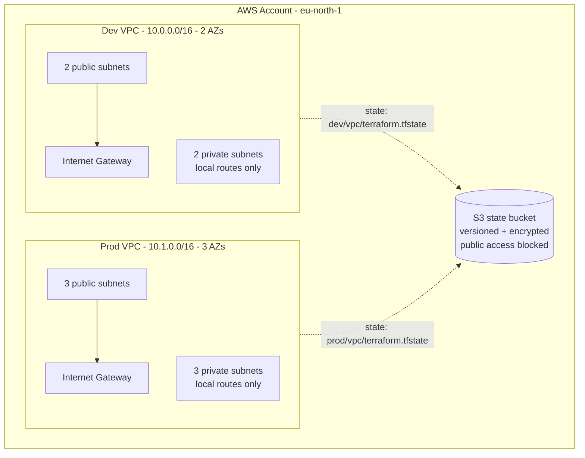

| Component | Purpose |
|---|---|
| `modules/s3-backend` | Creates the state bucket with versioning, SSE-S3 encryption, public access block, ACLs disabled, a restrictive bucket policy and a least-privilege IAM policy. |
| `modules/vpc` | Creates a VPC, public and private subnets spread across AZs, an Internet Gateway, and public/private route tables. |
| `bootstrap/` | Root config that uses the `s3-backend` module to create the state bucket. Uses **local** state (see below). |
| `environments/dev` | Root config that deploys the VPC module with dev values. State is stored in S3. |
| `environments/prod` | Same module and code as dev, with prod values and a separate state key. |

### Repository structure

```
.
├── modules/
│   ├── s3-backend/      # main.tf, variables.tf, outputs.tf, versions.tf
│   └── vpc/             # main.tf, variables.tf, outputs.tf, versions.tf
├── bootstrap/           # creates the remote state bucket (local state)
├── environments/
│   ├── dev/             # backend "s3" -> dev/vpc/terraform.tfstate
│   └── prod/            # backend "s3" -> prod/vpc/terraform.tfstate
├── logs/                # captured terraform/CLI output used as evidence
└── screenshots/         # console and terminal evidence
```

---

## Why a bootstrap step? (the chicken-and-egg problem)

Terraform cannot store its state in a bucket that does not exist yet. So:

1. **`bootstrap/`** creates the S3 bucket using **local state**. It is run once.
2. **`environments/*`** declare a `backend "s3"` block that points at that bucket. From then on, their state lives remotely.

The bootstrap's local `terraform.tfstate` is kept out of Git by `.gitignore`.

---

## Security controls on the state bucket

| Control | Implementation |
|---|---|
| Versioning | `aws_s3_bucket_versioning`: any previous state file can be restored if one is corrupted or deleted |
| Encryption at rest | `aws_s3_bucket_server_side_encryption_configuration` (AES256) plus `encrypt = true` in the backend |
| No public access | `aws_s3_bucket_public_access_block`: all four settings `true` |
| ACLs disabled | `aws_s3_bucket_ownership_controls`: `BucketOwnerEnforced` |
| HTTPS only | Bucket policy `DenyInsecureTransport`: denies any request where `aws:SecureTransport = false` |
| Authorized principals only | Bucket policy `DenyUnauthorizedStateAccess`: denies Get/Put/Delete/List to every principal not in `authorized_principal_arns` |
| Least-privilege IAM | `aws_iam_policy` granting only `s3:ListBucket` on the bucket and `s3:GetObject/PutObject/DeleteObject` on its objects |
| State locking | `use_lockfile = true`: S3-native locking (Terraform >= 1.10), no DynamoDB table needed |

---

## How to deploy

### Prerequisites
- Terraform >= 1.10, AWS CLI v2
- AWS credentials configured (`aws configure`) for an IAM user, not root
- Verify with: `aws sts get-caller-identity`

### 1. Bootstrap the remote backend (once)
```bash
cd bootstrap
# set project_name and state_admin_user_names in terraform.tfvars
terraform init
terraform plan -out=tfplan
terraform apply tfplan
terraform output state_bucket_name   # copy this value
```

### 2. Initialize an environment against the S3 backend
Put the bucket name into the `backend "s3"` block in `environments/<env>/versions.tf`. Backend blocks cannot use variables.

```hcl
backend "s3" {
  bucket       = "<state_bucket_name>"
  key          = "dev/vpc/terraform.tfstate"   # prod/vpc/... for prod
  region       = "eu-north-1"
  encrypt      = true
  use_lockfile = true
}
```
```bash
cd environments/dev
terraform init        # -> Successfully configured the backend "s3"!
terraform plan -out=tfplan
terraform apply tfplan
```
Repeat in `environments/prod`.

### 3. Confirm state is remote
```bash
aws s3 ls s3://<state_bucket_name> --recursive
terraform state list
```

---

## Environment separation (Dev vs Prod)

Both environments use **identical code** and the **same VPC module**. Only `terraform.tfvars` and the backend `key` differ:

| Setting | Dev | Prod |
|---|---|---|
| `vpc_cidr` | `10.0.0.0/16` | `10.1.0.0/16` |
| `az_count` | 2 | 3 |
| Public subnets | `10.0.1.0/24`, `10.0.2.0/24` | `10.1.1.0/24`, `10.1.2.0/24`, `10.1.3.0/24` |
| Private subnets | `10.0.101.0/24`, `10.0.102.0/24` | `10.1.101.0/24`, `10.1.102.0/24`, `10.1.103.0/24` |
| State key | `dev/vpc/terraform.tfstate` | `prod/vpc/terraform.tfstate` |
| Resources created | 12 | 16 |

Separate state keys mean a `terraform apply` in dev can never change prod.

---

## Variables

### `modules/vpc`
| Name | Type | Default | Description |
|---|---|---|---|
| `name` | string | - | Name prefix for all resources |
| `cidr_block` | string | - | VPC CIDR (validated as a valid IPv4 CIDR) |
| `public_subnet_cidrs` | list(string) | - | One CIDR per public subnet |
| `private_subnet_cidrs` | list(string) | - | One CIDR per private subnet |
| `az_count` | number | `2` | Number of AZs to spread subnets across |
| `tags` | map(string) | `{}` | Extra tags |

### `modules/s3-backend`
| Name | Type | Default | Description |
|---|---|---|---|
| `bucket_name` | string | - | Globally unique bucket name (validated) |
| `authorized_principal_arns` | list(string) | - | Only these principals may read/write state |
| `authorized_user_names` | list(string) | `[]` | IAM users that get the least-privilege policy attached |
| `force_destroy` | bool | `false` | Allow deleting a non-empty bucket |
| `tags` | map(string) | `{}` | Extra tags |

### `environments/dev` and `environments/prod`
| Name | Type | Default | Description |
|---|---|---|---|
| `aws_region` | string | `eu-north-1` | Deployment region |
| `project_name` | string | - | Prefix for resource names and tags |
| `environment` | string | - | `dev` or `prod` (validated) |
| `vpc_cidr` | string | - | Passed to the VPC module |
| `public_subnet_cidrs` | list(string) | - | Passed to the VPC module |
| `private_subnet_cidrs` | list(string) | - | Passed to the VPC module |
| `az_count` | number | `2` | Passed to the VPC module |

---

## Outputs

| Config | Output | Description |
|---|---|---|
| `modules/vpc` | `vpc_id`, `vpc_cidr_block` | VPC identifiers |
| | `public_subnet_ids`, `private_subnet_ids` | Subnet IDs |
| | `internet_gateway_id` | IGW ID |
| | `public_route_table_id`, `private_route_table_id` | Route table IDs |
| | `availability_zones` | AZs used |
| `modules/s3-backend` | `bucket_name`, `bucket_arn`, `bucket_region` | State bucket details |
| | `state_access_policy_arn` | Least-privilege IAM policy ARN |
| `bootstrap` | `state_bucket_name`, `state_bucket_arn`, `state_bucket_region`, `state_access_policy_arn` | Re-exported from the module |
| `environments/*` | `vpc_id`, `vpc_cidr_block`, `public_subnet_ids`, `private_subnet_ids`, `internet_gateway_id`, `availability_zones` | Re-exported from the VPC module |

---

## Evidence

### 1. Bootstrap: creating the state bucket
| | |
|---|---|
| Plan | 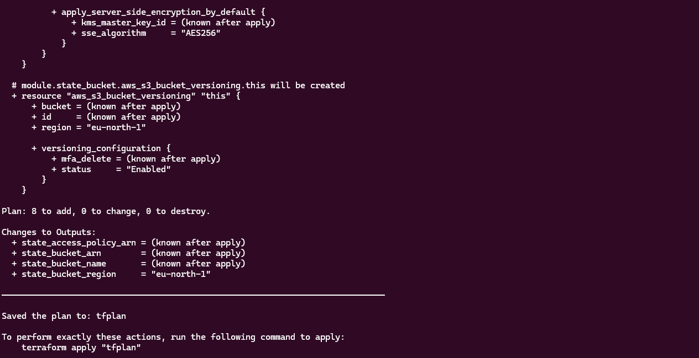 |
| Apply | 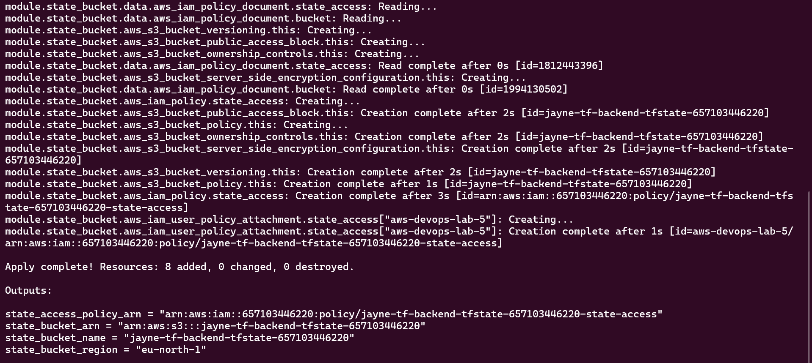 |

Logs: [`01-bootstrap-plan.log`](logs/01-bootstrap-plan.log), [`02-bootstrap-apply.log`](logs/02-bootstrap-apply.log)

### 2. S3 bucket security verification
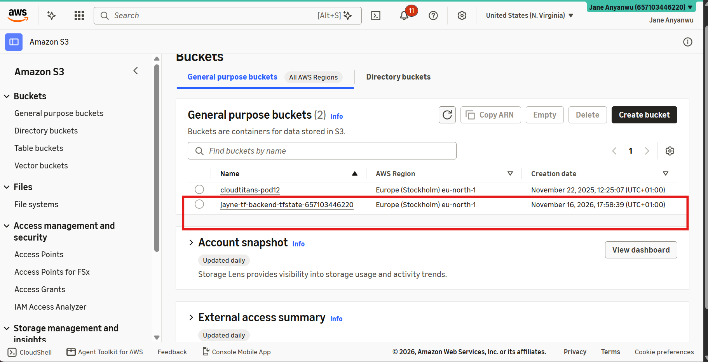
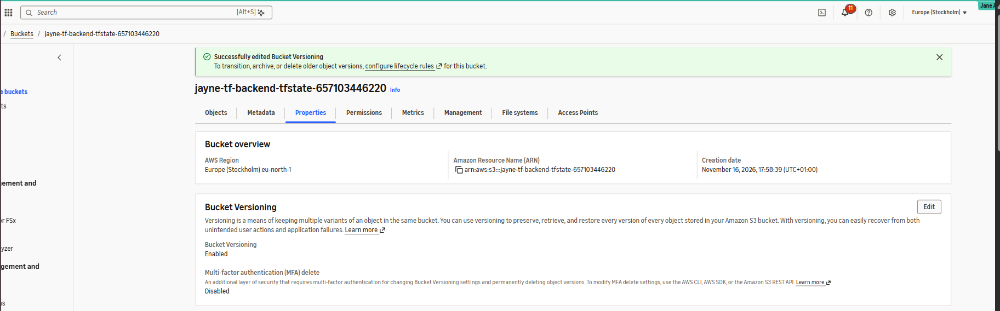
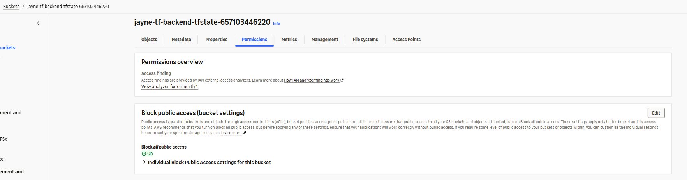
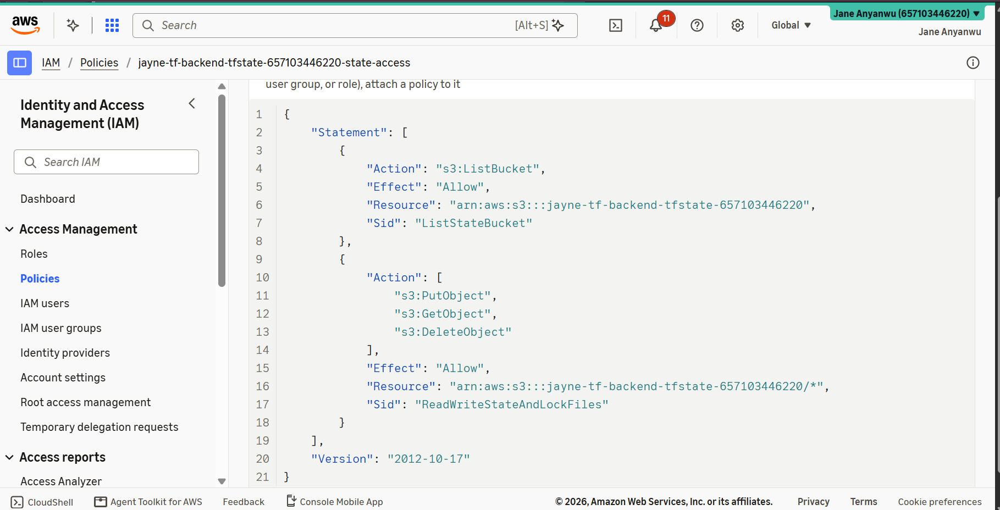

CLI verification log: [`03-s3-bucket-security-verification.log`](logs/03-s3-bucket-security-verification.log)

### 3. State management proof: S3 remote backend
`terraform init` successfully configuring the S3 backend:

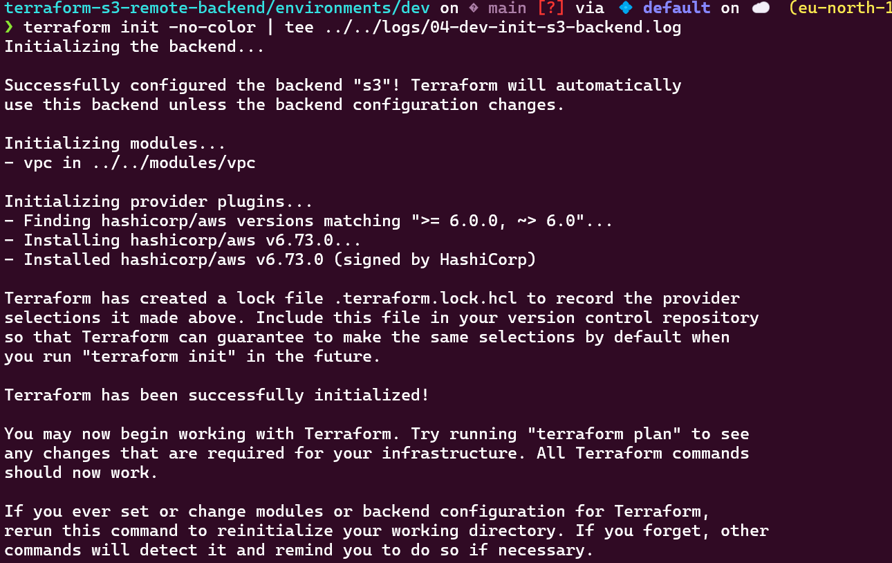

Logs: [`04-dev-init-s3-backend.log`](logs/04-dev-init-s3-backend.log), [`08-prod-init-s3-backend.log`](logs/08-prod-init-s3-backend.log)

State stored in S3, with no local `terraform.tfstate`:

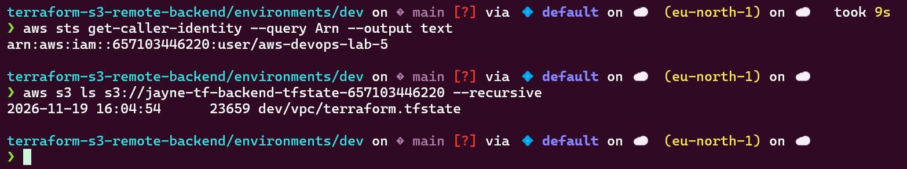

Log: [`07-dev-remote-state-proof.log`](logs/07-dev-remote-state-proof.log)

### 4. Access control in action
The console was signed in as an identity that is **not** in `authorized_principal_arns`, so the bucket policy denied listing the state objects:

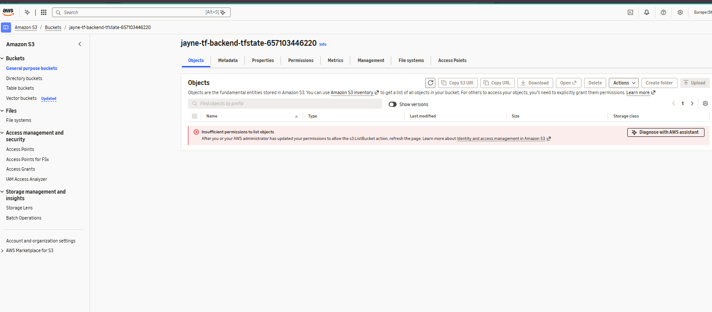

### 5. Dev deployment
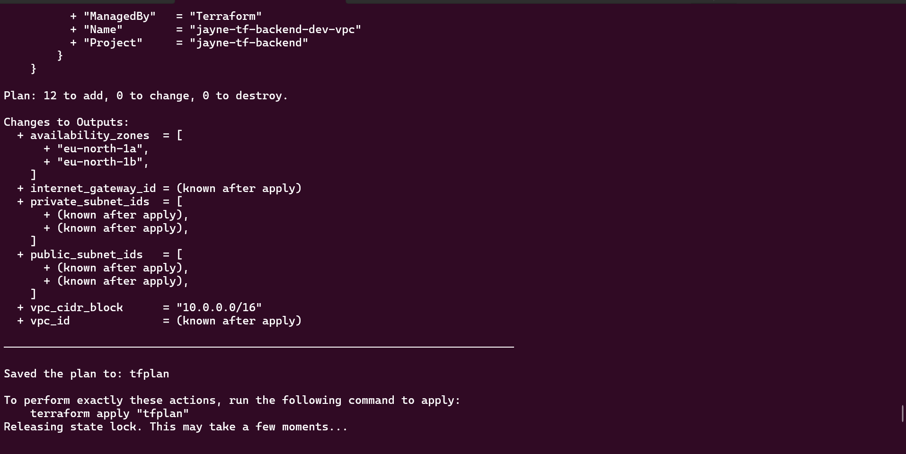
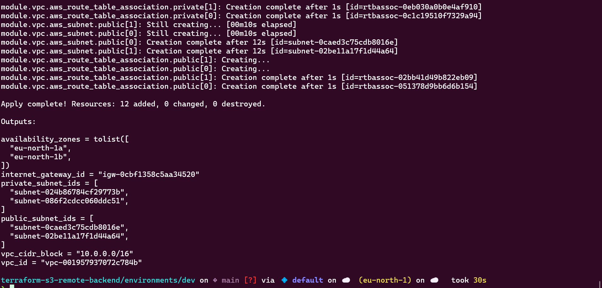

Logs: [`05-dev-plan.log`](logs/05-dev-plan.log), [`06-dev-apply.log`](logs/06-dev-apply.log)

### 6. Prod deployment and environment separation
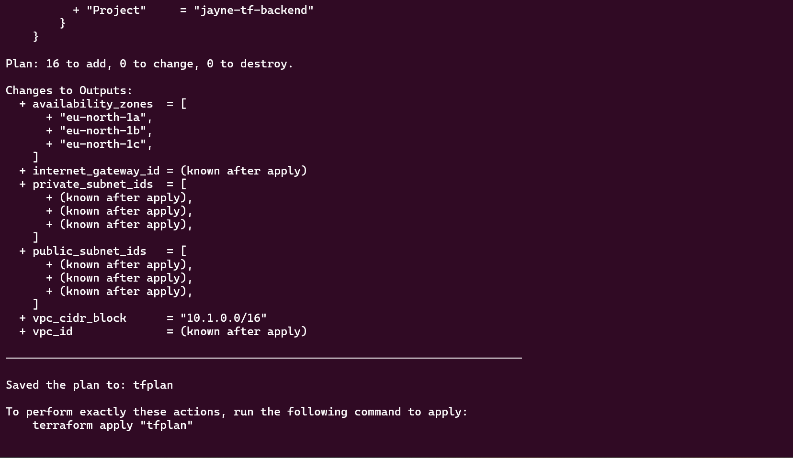
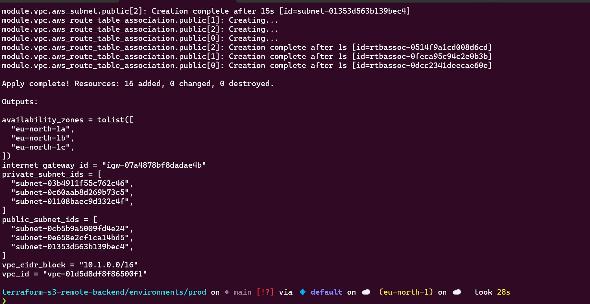
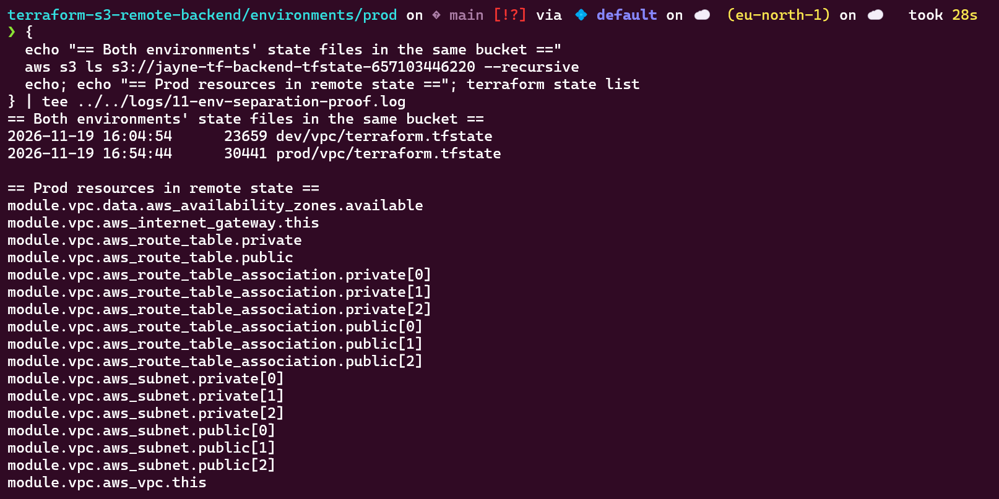

Logs: [`09-prod-plan.log`](logs/09-prod-plan.log), [`10-prod-apply.log`](logs/10-prod-apply.log), [`11-env-separation-proof.log`](logs/11-env-separation-proof.log)

### 7. Infrastructure verification: AWS console


---

## Design decisions
- **No NAT Gateway:** private subnets use local routes only, to keep the lab at zero hourly cost. In production, a NAT Gateway per AZ would give private subnets outbound internet access.
- **S3-native locking instead of DynamoDB:** `use_lockfile` is the current recommended approach for Terraform >= 1.10.
- **Provider pinning:** modules declare a minimum (`>= 6.0`), and root configs pin `~> 6.0`. `.terraform.lock.hcl` is committed for reproducible installs.
- **Not committed:** `*.tfstate`, `tfplan` and `.terraform/` are excluded by `.gitignore`.

## Cleanup
Destroy in reverse order:
```bash
cd environments/prod && terraform destroy
cd ../dev && terraform destroy
```
The state bucket has `force_destroy = false` and versioning on, to protect state. To remove it, empty all object versions first, then run `terraform destroy` in `bootstrap/`.

## Author
**Jane Anyanwu** · [GitHub](https://github.com/jayneAnya) · [LinkedIn](https://www.linkedin.com/in/anyanwu-jane)
